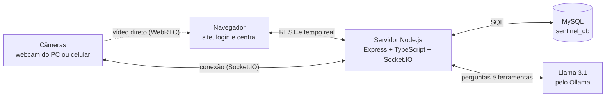
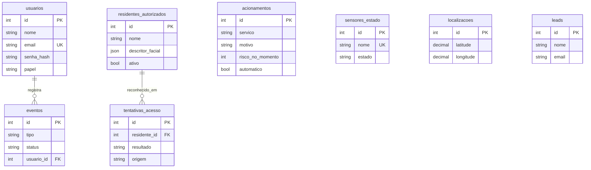
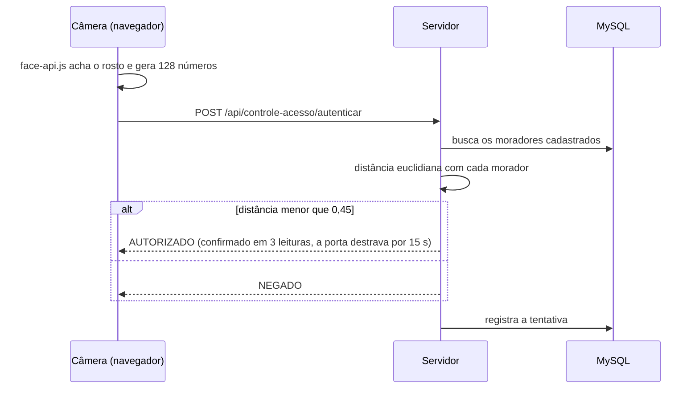

# 🛡️ Sentinel — Central de Segurança Residencial

**Projeto Integrador · Análise e Desenvolvimento de Sistemas · UniFECAF · ExpoTech 2026.2**

O Sentinel é uma central de segurança residencial na web. Ele junta numa tela só
as câmeras, os sensores da casa, o reconhecimento facial e um assistente com
inteligência artificial, e transforma a situação da casa num **índice de risco
de 0 a 100%** que reage sozinho quando fica crítico.

> 🎥 **Vídeo pitch (3 min):** _https://youtu.be/wU1JjVLmbos_
>
> ⚠️ As chamadas para polícia e bombeiros são **simuladas**: nenhuma ligação real
> é feita. O acionamento só fica registrado no banco de dados.

---

## O problema e a solução

Hoje a segurança de uma casa está espalhada: a câmera fica num aplicativo, o
alarme em outro e os sensores em outro. O morador reage tarde e, na emergência,
não sabe o tamanho do risco nem a quem chamar.

O Sentinel resolve isso com:

- **Câmeras com reconhecimento facial:** a webcam ou um celular viram câmeras. O morador é reconhecido e a porta destrava sozinha.
- **Planta da casa com sensores:** porta, janela, fumaça e gás, com o índice de risco calculado em tempo real.
- **Emergência automática:** a partir de 90% de risco, chama bombeiros ou polícia (simulado), com 5 segundos para cancelar.
- **Assistente com IA:** o Llama 3.1, rodando no próprio PC, responde sobre a casa e executa pedidos.
- **Tempo real:** todas as telas abertas atualizam juntas, sem recarregar.

## Equipe

| Integrante | Responsabilidade | Principais arquivos |
| --- | --- | --- |
| **Gabriel** | Front-end e design (Figma) | `frontend/*.html`, `*.css`, `site.js`, `auth.js` |
| **Davi** | Biometria facial e índice de risco | `backend/src/routes/acesso.ts`, `backend/src/riskEngine.ts`, reconhecimento em `frontend/cameras.js` |
| **Everton** | Assistente com IA e dependências | `backend/src/ia.ts`, `backend/src/routes/assistente.ts`, `frontend/chat.js`, `frontend/assistente.js`, `backend/package.json` |
| **Laryssa** | Integração, banco de dados e tempo real | `backend/src/server.ts`, `backend/sql/schema.sql`, `backend/src/tempoReal.ts`, rotas, `frontend/painel.js` |

## Arquitetura



- O **servidor** entrega o front-end e a API REST, e usa **Socket.IO** para avisar todas as telas quando algo muda.
- O **reconhecimento facial** roda no navegador (face-api.js, com os modelos dentro do projeto: funciona sem internet); o servidor só compara os vetores com o banco.
- O **vídeo do celular** vai direto para o painel por WebRTC; o servidor só apresenta um aparelho ao outro.

## Tecnologias

| Camada | Tecnologias |
| --- | --- |
| Front-end | HTML, CSS e JavaScript puro, SVG (planta), face-api.js, WebRTC |
| Back-end | Node.js 20+, Express 5, TypeScript, Socket.IO |
| Banco de dados | MySQL 8 (mysql2) |
| Segurança | bcrypt (hash de senha), JWT (sessão), HTTPS com certificado próprio |
| IA | Llama 3.1 pelo Ollama (local), com *tool calling* |
| Design | Figma |

## Estrutura de pastas

```
sentinel/
├── README.md
├── docs/
│   └── API.md                 todas as rotas da API
├── frontend/                  telas (HTML, CSS e JS puro)
│   ├── index.html             site de apresentação (abre em /)
│   ├── login.html             login            ┐ auth.js / auth.css
│   ├── cadastro.html          cadastro          ┘
│   ├── painel.html            central de segurança
│   ├── painel.js              sensores, risco, emergência, tempo real
│   ├── cameras.js             câmeras, reconhecimento facial, celular
│   ├── chat.js                tela do assistente
│   ├── assistente.js          modo local do assistente (sem IA)
│   ├── celular.html/.js       transforma o celular em câmera
│   └── base.css               cores e fonte do Figma
└── backend/
    ├── package.json           dependências e comandos
    ├── testar-api.js          testes automatizados (npm test)
    ├── .env.example           modelo de configuração
    ├── sql/schema.sql         criação do banco
    └── src/
        ├── server.ts          servidor: rotas, HTTPS e Socket.IO
        ├── db.ts              conexão com o MySQL
        ├── migrate.ts         cria o banco e o usuário de teste
        ├── riskEngine.ts      índice de risco
        ├── ia.ts              assistente com IA (tool calling)
        ├── tempoReal.ts       Socket.IO
        ├── camerasSignaling.ts  conexão das câmeras de celular
        ├── middleware/authMiddleware.ts  confere o token JWT
        └── routes/            uma rota por assunto
```

## Como rodar

**Pré-requisitos:** Node.js 20 ou mais novo, MySQL 8 e Ollama.

```bash
# 1. Baixe o modelo de IA (uma vez só, cerca de 5 GB)
ollama pull llama3.1

# 2. Configure e instale
cd backend
copy .env.example .env      # no Linux/Mac: cp .env.example .env
#    abra o .env e coloque a senha do seu MySQL em DB_PASSWORD
npm install

# 3. Crie o banco e ligue o servidor
npm run migrate
npm run dev
```

Abra **http://localhost:3001** e entre com `operador@sentinel.com` / `Sentinel123`.

**Câmera do celular:** com `HTTPS=true` no `.env`, clique em "Conectar celular"
no painel e escaneie o QR Code (celular e PC no mesmo Wi-Fi).

## Banco de dados



- Todas as tabelas têm chave primária `id`.
- `tentativas_acesso.residente_id` e `eventos.usuario_id` são **chaves estrangeiras** com `ON DELETE SET NULL`: o histórico continua se o morador ou usuário for removido.
- "Últimos acessos" usa um **JOIN** entre `tentativas_acesso` e `residentes_autorizados`.
- O rosto é guardado só como **vetor de 128 números**, nunca como foto.

## Como funciona o reconhecimento facial



**Cuidados contra identificação errada:**

- Limite de **0,45**: abaixo disso é o mesmo rosto (ajustável com `LIMITE_FACIAL` no `.env`).
- **Ambiguidade:** se o rosto estiver quase igual distante de dois moradores (diferença menor que 0,06), o sistema nega em vez de escolher um.
- **Confirmação:** a porta só destrava depois de **3 leituras seguidas** com o mesmo resultado. Enquanto isso, a câmera mostra "Verificando… 1/3".
- **Rosto longe** (menos de 90 pixels de largura) não é identificado: a câmera pede "Chegue mais perto".
- **Cadastro seguro:** o "Memorizar rosto" exige uma pessoa só na imagem, faz 3 leituras que precisam bater entre si e bloqueia o cadastro se o rosto já for de um morador.
- A distância aparece junto do nome na câmera (por exemplo, `Ana · 0,31`), para explicar cada decisão.

### Erro encontrado na apresentação e como foi corrigido

Na avaliação em sala, uma pessoa foi cadastrada e outra, diferente, foi
reconhecida com o mesmo nome. A investigação encontrou a causa:

1. A face-api.js entrega o vetor do rosto como `Float32Array`. Ao ser enviado
   em JSON, ele virava um **objeto** (`{"0": -0.08, "1": ...}`) e era salvo
   assim no MySQL.
2. Na comparação, o servidor usava `vetor.length`, que não existe em objeto.
   O cálculo virava `NaN`, nenhuma diferença era somada e a **distância dava 0**,
   ou seja, "rosto idêntico".
3. Com isso, **qualquer pessoa** era reconhecida como a primeira cadastrada.

**Correção:** o navegador converte o vetor para lista (`Array.from`), o servidor
aceita só listas de 128 números (e converte cadastros antigos salvos como
objeto) e vetores inválidos nunca são considerados iguais. Os testes
automatizados reproduzem o erro e confirmam a correção. Também removemos um
cache de 8 segundos no navegador que podia reaproveitar o nome da pessoa
anterior.

## Índice de risco

| Situação | Pontos |
| --- | --- |
| Casa normal (base) | 10% |
| Janela aberta | +20 |
| Porta aberta | +25 |
| Vazamento de gás | +50 |
| Fumaça | +70 |
| Pessoa procurada na câmera | +90 |

Até 29% é **baixo**, de 30 a 69% é **moderado** e a partir de 70% é **alto**.
A partir de **90%**, o Sentinel aciona sozinho os bombeiros (fumaça ou gás) ou a
polícia (procurado), com 5 segundos para cancelar. A regra roda no navegador e
também no servidor, que registra o acionamento mesmo com o painel fechado (no
máximo um por minuto para cada serviço).

## Assistente com IA

O assistente usa o **Llama 3.1** pelo **Ollama**, rodando no próprio computador:
gratuito e sem depender de internet. Ele usa ***tool calling***: recebe uma
lista de ferramentas e decide qual usar.

| Tipo | Ferramentas | Quem executa |
| --- | --- | --- |
| Ação no painel | trancar a porta, ligar o reconhecimento facial, ligar a detecção de movimento, tirar foto, gravar câmera, abrir uma seção, acionar emergência | o navegador |
| Consulta ao banco | eventos, acessos e acionamentos | o servidor, no MySQL |

Cada mensagem leva junto o estado atual da casa, então a IA responde com base no
que está acontecendo. Sem o Ollama, o assistente continua funcionando no
**modo local**, que reconhece os pedidos mais comuns por palavras-chave.

### Requisitos da IA local (memória e tempo de resposta)

| Item | Valor de referência |
| --- | --- |
| Download do modelo `llama3.1` (8B) | cerca de 5 GB |
| Memória ocupada com o modelo carregado | cerca de 5 a 7 GB de RAM |
| Primeira resposta (o modelo ainda está carregando) | de 10 a 30 segundos |
| Respostas seguintes, em computador sem placa de vídeo dedicada | de 2 a 10 segundos |
| Alternativa mais leve | `qwen2.5:3b`, cerca de 2 GB |

Os valores variam conforme o computador, por isso o Sentinel **mede de verdade**:

- Cada resposta mostra o modelo e o tempo gasto, e o terminal registra `🧠 llama3.1 respondeu em 3.4 s`.
- `GET /api/assistente/status` devolve a última latência, a média e a **memória que o modelo ocupa**, lida do próprio Ollama.

As ações críticas **não dependem da IA**: reconhecimento facial, sensores e
emergência funcionam sozinhos. O assistente só consulta e executa pedidos.

## Segurança

- Senhas guardadas com **hash bcrypt** (sem volta).
- Login com **token JWT** de 12 horas; o middleware `exigirAutenticacao` protege a rota da IA.
- Limite de 20 mensagens por minuto no assistente.
- Consultas SQL **parametrizadas** (`?`), contra SQL injection.
- O `.env` com a senha do banco **não vai para o GitHub** (`.gitignore`).

## Testes

Com o servidor ligado, em outro terminal:

```bash
cd backend
npm test
```

São 14 testes nas rotas reais: login e token, senha errada (401), rota da IA
sem login (401), cadastro de morador, rosto igual autorizado, rosto diferente
negado, vetor inválido (400), rosto parecido acima do limite negado, rosto
ambíguo entre dois moradores negado, **o erro da apresentação** (vetor salvo
como objeto), risco subindo para 35% com a porta aberta e voltando para 10%,
e registro de evento no MySQL.

## API

A lista completa de rotas está em **[docs/API.md](docs/API.md)**.

## Limitações e próximos passos

- Os sensores ainda são **simulados** na tela. O próximo passo é uma placa
  **ESP32** com sensor de gás e fumaça (**MQ-2**) e sensor de porta
  (**reed switch**). Ela usaria a rota já existente `PUT /api/sensores/:campo`,
  e o painel atualizaria sozinho pelo Socket.IO.
- Publicar o sistema online.
- Aplicativo para o morador.

---

Projeto acadêmico desenvolvido por **Gabriel, Davi, Everton e Laryssa**, ADS UniFECAF, 2026.
